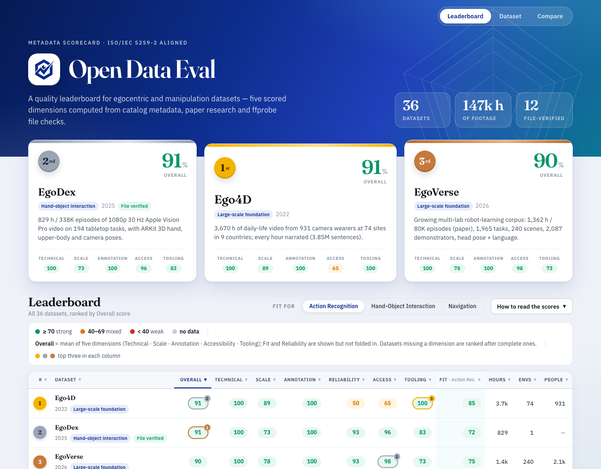

# Open Data Eval

> What is good data? We're building the systematic quality evaluation suite for AI/ML datasets.

[](https://github.com/Varun-Nair/open-data-eval)
[](https://varun-nair.github.io/open-data-eval/scorecard/)
[](https://varun-nair.github.io/open-data-eval/scorecard/)
[](https://www.iso.org/standard/81088.html)
[](LICENSE)
[](https://github.com/Varun-Nair/open-data-eval/issues)

We audit ML datasets the way code gets audited — systematically, quantitatively, transparently.

---

## Live Scorecard

**[varun-nair.github.io/open-data-eval/scorecard/](https://varun-nair.github.io/open-data-eval/scorecard/)**

Interactive quality profiles for 36 egocentric and manipulation datasets. Scores computed from catalog metadata and paper research. ISO/IEC 5259-2 aligned.

The page opens on a **ranked leaderboard**: every dataset gets an Overall score (0–100), the top three stand on a podium, and the best three in each column are highlighted. Click any row for a **per-dataset page** with official links (project, paper, Hugging Face, GitHub, download), sample media, and a 13-type annotation inventory (narrations, action labels, hand pose, gaze, depth, ...). An inline **"How to read the scores"** guide and a tooltip on every score explain exactly how each number is computed and what a high value does and does not mean.



---

## Quick Start

1. **Browse the leaderboard** → [varun-nair.github.io/open-data-eval/scorecard/](https://varun-nair.github.io/open-data-eval/scorecard/) — datasets ranked by Overall score; switch the Fit column to your use case and hover any score to see how it was computed
2. **Open a dataset page** → official links (project, paper, Hugging Face, GitHub, download), sample media, the annotation inventory, and every score with its explanation
3. **Read its quality profile** → `data/quality-profiles/profiles/<dataset>.qp.json` (Croissant-compatible JSON-LD)

---

## What We Evaluate

| Dimension | What it measures | Status |
|-----------|-----------------|--------|
| Technical | FPS, resolution, audio | ✅ Live |
| Accessibility | License, download, docs | ✅ Live |
| Reliability | Calibration, annotation coverage | ✅ Live |
| Scale & Diversity | Hours, environments, participants | ✅ Live |
| Downstream Fit | Modality fit per use-case | ✅ Live |
| Content Quality | Hand visibility, scene diversity | 🔜 Phase 1b |
| Derivative | Model lift per dataset | 🔜 Phase 3 |

---

## Dataset Catalog

116 egocentric video datasets audited across 33 fields each.

| Metric | Value |
|--------|-------|
| Datasets audited | 116 |
| Total video hours | 152,500+ |
| Fully accessible | 104 (90%) |
| Broken downloads | 5 (4%) |
| Dead links | 4 (3%) |
| **No license specified** | **67 of 116 (58%)** |

### URL Status
```
Live                ████████████████████████████████████████████ 104
Broken download     ██ 5
Dead                ██ 4
Redirect            █ 2
Live but gated      █ 1
```

### Access Level
```
Open                ████████████████████████████████████████████ 79
Gated-Open          ██████████████ 25
Restricted          █████ 9
Unavailable         ██ 3
```

### License
```
Not specified       ████████████████████████████████████████████ 67
CC-BY-NC-4.0        ██████████ 15
Custom Academic     █████████ 14
Custom Open         ████ 6
Apache-2.0          ███ 5
CC-BY-4.0           ██ 3
CC-BY-NC-SA-4.0     █ 2
S-Lab License       █ 1
Mixed               █ 1
CC-BY-NC-ND-4.0     █ 1
CC-BY-SA-4.0        █ 1
```

### Modalities (across all 116 datasets)
```
RGB Video           ████████████████████████████████████████████ 116
Eye Gaze            ████████████ 31
Hand Pose           ████████████ 31
IMU                 ███████████ 29
Body Pose           █████████ 23
Depth (RGB-D)       ████████ 20
Audio               ███████ 19
Narrations          ███████ 18
SLAM/Odometry       ███████ 18
3D Point Clouds     █████ 14
3D Scene Recon.     ███ 8
Depth (Stereo)      ███ 8
Motion Capture      ███ 7
Multi-view          ██ 4
Optical Flow        █ 2
Hand Masks          █ 2
Object Tracking     █ 1
mmWave              █ 1
3D Hand Pose        █ 1
Object BBoxes       █ 1
Tactile             █ 1
```

### Accessibility Rankings

Which datasets are easiest to actually get and use?

| Rank | Dataset | Score | Access | License | Summary |
|------|---------|-------|--------|---------|---------|
| 1 | EPIC-KITCHENS-100 | 9.8 | Open | CC-BY-NC-4.0 | Gold standard kitchen ego dataset. 3 download options incl. Academic Torrents. |
| 2 | HO-Cap | 9.5 | Open | CC-BY-4.0 | Multi-view RGB-D with HoloLens ego. Best-licensed hand-object dataset. |
| 3 | EPIC-KITCHENS-55 | 9.2 | Open | CC-BY-NC-4.0 | Superseded by EK-100 but still clean and fully accessible. |
| 4 | DexYCB | 9.2 | Open | CC-BY-NC-4.0 | NVIDIA multi-view hand-grasping benchmark. Direct download, confirmed license. |
| 5 | EgoDex | 9.2 | Open | CC-BY-NC-ND-4.0 | 829h from Apple Vision Pro. Direct curl download from Apple CDN. |

Full rankings: [`data/ego-datasets/accessibility_rankings.csv`](data/ego-datasets/accessibility_rankings.csv)

<details>
<summary>Top issues (broken links, missing licenses, unverified downloads)</summary>

| Dataset | Issue | Severity |
|---------|-------|----------|
| FPVO | Primary URL dead. Dataset unavailable. | High |
| EgoSim | Download availability not confirmed. | High |
| ADL4D | Download availability not confirmed. | High |
| VEDB | Download availability not confirmed. | High |
| EgoCampus | Download availability not confirmed. | High |
| Sanctuaria-Gaze | Download availability not confirmed. | High |
| EasyCom | Download availability not confirmed. | High |
| MultiEgo | Download availability not confirmed. | High |
| CEN | Download availability not confirmed. | High |
| PEDESTRIAN | Download availability not confirmed. | High |
| EgoBlind | Download availability not confirmed. | High |
| EgoExOR | Download availability not confirmed. | High |
| EgoVid-5M | Open data with no license specified. | Medium |
| GTEA | Open data with no license specified. | Medium |
| EGTEA Gaze+ | Open data with no license specified. | Medium |
| HOI4D | Open data with no license specified. | Medium |
| EgoHumans | Open data with no license specified. | Medium |
| EgoExoLearn | Open data with no license specified. | Medium |
| EgoProceL | Open data with no license specified. | Medium |
| EgoObjects | Open data with no license specified. | Medium |
| DR(eye)VE | Open data with no license specified. | Medium |
| EgoTaskQA | Open data with no license specified. | Medium |

67 open datasets have no license specified. Full list: [`issues_and_findings.csv`](data/ego-datasets/issues_and_findings.csv)

</details>

---

## Quality Profiles

Each dataset gets a machine-readable Quality Profile (QP) — a structured record of what a dataset is and how good it is, computed at a specific evaluation level.

- **Croissant-compatible JSON-LD** — slots into MLCommons metadata infrastructure
- **ISO/IEC 5259-2 aligned** — 9 of 23 quality characteristics mapped at metadata level
- **Progressively enriched** — metadata → file → frame → content (each phase adds depth)

36 profiles live in [`data/quality-profiles/profiles/`](data/quality-profiles/profiles/).

**Example: `data/quality-profiles/profiles/ego4d.qp.json`**

```json
{
  "@context": {
    "cr": "http://mlcommons.org/croissant/",
    "qp": "http://opendataeval.org/qp/",
    "iso": "http://opendataeval.org/iso5259/"
  },
  "@type": "cr:Dataset",
  "name": "Ego4D",
  "dct:conformsTo": "http://opendataeval.org/qp/1.0",
  "qp:qualityProfile": {
    "qp:schemaVersion": "1.0",
    "qp:evalLevel": "metadata",
    "qp:evaluatedAt": "2026-04-14",
    "scores": {
      "fps": { "score": 1.0, "raw_value": 30.0 },
      "resolution": { "score": 1.0, "short_edge": 1080 },
      "license_clarity": { "score": 0.5, "tier": "custom_named" },
      "accessibility": { "score": 0.80 },
      "annotation_coverage": { "score": 1.0 },
      "...": "13 scores total"
    },
    "classifications": ["capture_device", "lens_type", "video_format", "annotation_format"],
    "confidence": { "metadata_completeness": 0.87 }
  }
}
```

---

## Scoring Methodology

### Accessibility Score (0–10)

Ease of Access scores are computed from six components:

| Component | Max Points | How |
|-----------|-----------|-----|
| Access Level | 3 | Open=3, Gated=2, Restricted=1, Unavailable=0 |
| URL Status | 2 | Live=2, Broken/Redirect=1, Dead=0 |
| License Clarity | 2 | Standard (CC-BY, MIT, Apache)=2, Named custom=1, None=0 |
| Documentation | 1.5 | Excellent=1.5, Good=1, Basic=0.5, None=0 |
| Dataloader | 1 | Official loader (catalog says "Yes …")=1; community-only or none=0 |
| Commercial Clarity | 0.5 | Explicitly permitted=0.5, Explicitly banned=0.25, Unclear=0 |

### Metadata Eval (Phase 1a)

Quality profiles contain 13 numeric scores, computed from catalog metadata and paper research. The scorecard folds them into five dimensions (each the plain mean of its inputs, skipping missing values) plus two informational columns:

| Dimension | Scores averaged | Notes |
|-----------|-----------------|-------|
| Technical | FPS, resolution | 30 fps and a 1080p short edge both score 100; piecewise-linear below |
| Scale | Total hours | `log10(hours+1) / log10(10001)`; environment and participant diversity are reported separately, not in this dimension |
| Annotation | Annotation coverage | Fraction of footage annotated, read from the paper |
| Accessibility | License clarity, access level | Access level is the 0–10 score above (it already contains URL status, docs, dataloader and commercial-use clarity) |
| Tooling | Dataloader, documentation | Official loader naming PyTorch/TF/JAX/HF = 100, unnamed = 80, community = 50; docs rating ÷ 3 |
| Reliability *(column only)* | Camera calibration tier, annotation coverage | Not part of Overall |
| Downstream Fit *(column only)* | Modality richness for the selected use case | `cr² × (0.60 + 0.28·ir + 0.12·br)` over critical / important / bonus modalities; not part of Overall |

Each profile also includes 4 classifications (device, lens, video format, annotation format) and a metadata completeness confidence score. See [`docs/`](docs/) for the full specification.

### Overall score

**Overall** is the plain mean of the five scorecard dimensions — Technical, Scale, Annotation, Accessibility, Tooling — each on a 0–100 scale. A dimension with no data is skipped rather than counted as zero, and a dataset missing any dimension is ranked after all complete ones so a gap never inflates its rank. Downstream Fit depends on the use case you select, so it is shown as its own column and never folded into Overall; Reliability, diversity, download efficiency, citations and completeness are likewise informational.

Every score, dimension and the ranking rule is explained in plain English, with the exact thresholds, in [`docs/scorecard/metrics_guide.js`](docs/scorecard/metrics_guide.js) and in the page's "How to read the scores" panel.

---

## Data Files

| File | Description |
|------|-------------|
| [`data/ego-datasets/ego_dataset_catalog.csv`](data/ego-datasets/ego_dataset_catalog.csv) | Full catalog, 33 fields per dataset |
| [`data/ego-datasets/accessibility_rankings.csv`](data/ego-datasets/accessibility_rankings.csv) | All 115 datasets ranked by accessibility score |
| [`data/ego-datasets/access_summary.csv`](data/ego-datasets/access_summary.csv) | Aggregate counts by access level, license, modality, category |
| [`data/ego-datasets/issues_and_findings.csv`](data/ego-datasets/issues_and_findings.csv) | Flagged issues (dead links, unverified downloads, missing licenses) |
| [`data/ego-datasets/datasets_by_category.csv`](data/ego-datasets/datasets_by_category.csv) | Datasets grouped and ranked within each category |
| [`data/ego-datasets/datasets_by_family.csv`](data/ego-datasets/datasets_by_family.csv) | Dataset family groupings (EPIC-KITCHENS, Project Aria, Ego4D, etc.) |
| [`data/ego-datasets/catalog_health_report.csv`](data/ego-datasets/catalog_health_report.csv) | Per-dataset completeness audit (missing fields) |
| [`data/quality-profiles/profiles/`](data/quality-profiles/profiles/) | 36 machine-readable QP JSON files |
| [`docs/scorecard/`](docs/scorecard/) | GitHub Pages scorecard source |
| [`docs/scorecard/metrics_guide.js`](docs/scorecard/metrics_guide.js) | Plain-English explanation of every score, dimension and the leaderboard ranking; drives the page's guide panel and tooltips |
| [`data/ego-datasets/extras/`](data/ego-datasets/extras/) | Per-dataset curated extras: official links, Hugging Face id, 13-type annotation inventory, sample media (schema: [`docs/scorecard/EXTRAS_SCHEMA.md`](docs/scorecard/EXTRAS_SCHEMA.md)) |
| [`eval/build_extras.py`](eval/build_extras.py) | Validates every extras file and builds `docs/scorecard/dataset_extras.js` |

---

## Roadmap

- [x] Phase 0: Dataset catalog — 106 ego datasets, 33 fields each
- [x] Phase 1a: Metadata Eval — quality profiles for 36 datasets, live scorecard
- [x] Phase 1b: File Eval — ffprobe pipeline (eval/file_eval.py); first run on RoboX EgoGrasp v0.1
- [ ] Phase 1c: Frame Eval — ML models on sampled frames (hand visibility, blur, occlusion)
- [ ] Phase 2: Robot dataset catalog
- [ ] Phase 3: Derivative scoring — which data produces better models?
- [ ] Interactive comparison tool

---

## 5-Layer Scoring Framework

| Layer | Name | Signals |
|-------|------|---------|
| 1 | Technical Quality | Resolution, fps, codec, sharpness, frame drops |
| 2 | Content Quality | Hand visibility, action density, scene diversity |
| 3 | Collective Quality | Diversity indices, demographic balance, coverage |
| 4 | Derivative Quality | Downstream model lift — which data actually makes models better |
| 5 | Accessibility | License, download, documentation, dataloader |

Phase 1a covers Layer 5 fully and Layers 1–3 partially from metadata. Layers 2–4 require downloaded files and model runs.

---

## Contributing

Open an issue or PR. The catalog and quality profiles are the most useful place to contribute — adding missing fields, correcting errors, or extending coverage to new datasets.

Dataset extras are the easiest first contribution: add `data/ego-datasets/extras/<slug>.extras.json` (official links, Hugging Face id, annotation inventory, sample media — see [`docs/scorecard/EXTRAS_SCHEMA.md`](docs/scorecard/EXTRAS_SCHEMA.md)), then run `python3 eval/build_extras.py --check` before opening the PR.

Browse the [live scorecard](https://varun-nair.github.io/open-data-eval/scorecard/) to see what's been evaluated and what's missing.

---

## Citation

```bibtex
@misc{open-data-eval,
  author = {Varun Nair},
  title  = {Open Data Eval: A Systematic Quality Evaluation Suite for Egocentric and Multimodal Datasets},
  year   = {2026},
  url    = {https://github.com/Varun-Nair/open-data-eval}
}
```

---

*Licensed under [CC-BY-4.0](LICENSE). Copyright Varun Nair 2026.*
